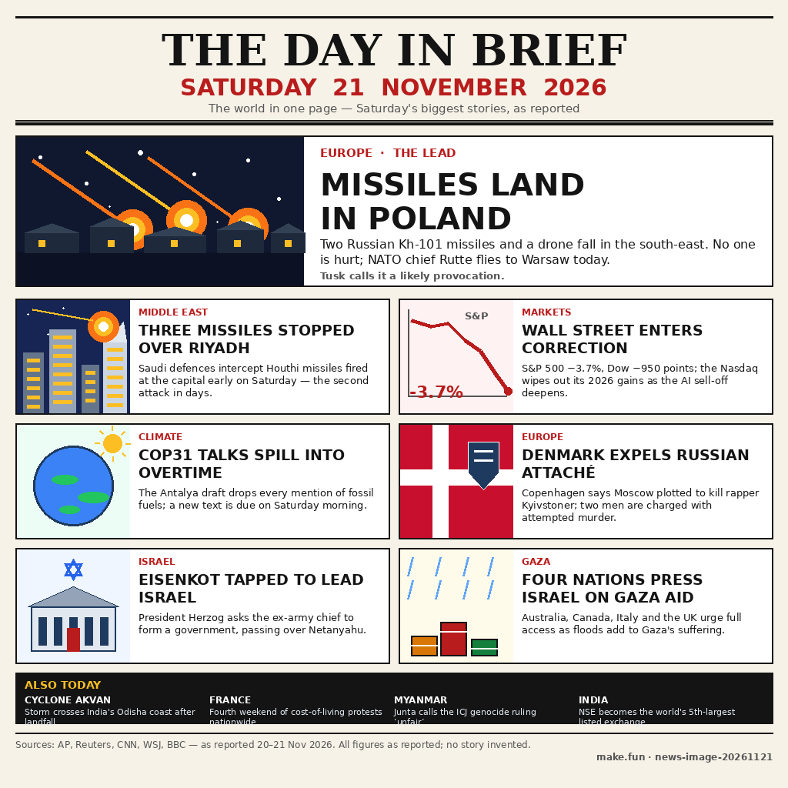

# The Day in Brief — Saturday 21 November 2026

[](https://make.fun/bounty/news-image-20261121?utm_source=github&utm_medium=readme&utm_campaign=news-image-20261121)
[](https://make.fun/bounty/news-image-20261121/leaderboard?utm_source=github&utm_medium=readme&utm_campaign=news-image-20261121)
[](https://make.fun/bounty/news-image-20261121?utm_source=github&utm_medium=readme&utm_campaign=news-image-20261121)

One page, the whole day: a dense broadsheet front page that sums up the
world news of **Saturday 21 November 2026** in a single 1024×1024 image —
a lead story, six illustrated stories, and an also-today strip.



## The front page

- **The lead · Poland** — Two Russian Kh-101 cruise missiles and a drone
  come down in south-east Poland; no one is hurt. NATO chief Mark Rutte
  flies to Warsaw the same day.
- **Riyadh** — Saudi defences intercept three Houthi missiles fired at
  the capital early on Saturday, the second attack in days.
- **Markets** — S&P 500 −3.7% and the Dow −950 points enter correction;
  the Nasdaq wipes out its 2026 gains as the AI sell-off deepens.
- **Climate** — COP31 talks spill into overtime in Antalya; the draft
  drops every mention of fossil fuels.
- **Denmark** — Copenhagen expels Russia's defence attaché, saying Moscow
  plotted to kill rapper Kyivstoner; two men are charged.
- **Israel** — President Herzog asks ex-army chief Gadi Eisenkot to form a
  government, passing over Netanyahu.
- **Gaza** — Australia, Canada, Italy and the UK press Israel to let aid
  reach flooded Gaza.
- **Also today** — Cyclone Akvan crosses India's Odisha coast; a fourth
  weekend of cost-of-living protests in France; Myanmar calls the ICJ
  genocide ruling "unfair"; India's NSE becomes the world's 5th-largest
  listed exchange.

Every story comes from the day's reporting (AP, Reuters, CNN, WSJ, BBC);
no story is invented, and figures are as reported that day.

## Run it

```sh
python3 tools/render.py   # redraws entry.png (needs Pillow, local use only)
python3 main.py            # writes /output/entry.png
MAKEFUN_OUTPUT_DIR=/tmp/out python3 main.py
```

`main.py` is standard library only: it verifies the shipped `entry.png`
(PNG, ≤1 MiB, ≤1024×1024) and copies it byte for byte to
`/output/entry.png`, so the graded program runs twice with identical
output and no network.
